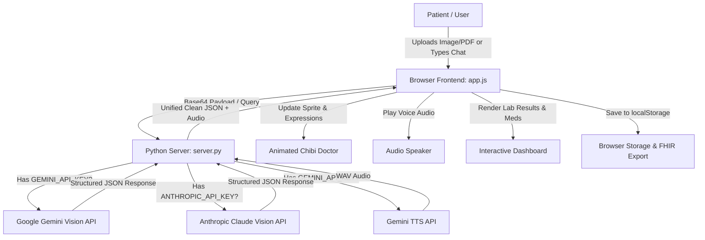

# 🩺 Mr.Doc – Personal AI Health Copilot

<div align="center">

  

  <h3><em>Your Warm, Multilingual Medical Record Companion & Chibi Doctor Guide</em></h3>

  <p>
    <strong>Translating complex medical reports, prescriptions, and lab tests into plain, reassuring language in your mother tongue.</strong>
  </p>

  <p>
    
    
    
    
    
    
    
  </p>
</div>

---

## 📑 Table of Contents
- [Overview](#-overview)
- [Visual Screen & Character Layout](#-visual-screen--character-layout)
- [Key Features](#-key-features)
- [How It Works (End-to-End Workflow)](#-how-it-works-end-to-end-workflow)
- [System Architecture](#-system-architecture)
- [Dependencies & Prerequisites](#-dependencies--prerequisites)
- [Quickstart: How to Run](#-quickstart-how-to-run)
- [Configuration (.env)](#-configuration-env)
- [Repository Structure](#-repository-structure)
- [API Endpoints Reference](#-api-endpoints-reference)
- [Privacy & Medical Disclaimer](#-privacy--medical-disclaimer)

---

## 🌟 Overview

**Mr.Doc** is an intelligent, privacy-first personal health copilot designed to empower patients and families. Medical records, discharge summaries, and lab reports are frequently packed with intimidating clinical terminology, complex reference ranges, and illegible handwriting. 

Mr.Doc bridges this gap:
- **Upload Any Health Document:** Take a photo or upload a PDF of prescriptions, blood tests, or discharge summaries.
- **Multimodal AI OCR:** Automatically reads and parses medications, dosages, lab values, and clinical findings.
- **Plain-Language Explanations:** Explains what high/low test numbers mean and highlights danger signs without clinical jargon.
- **Interactive Animated Doctor:** A friendly chibi avatar with real-time facial expressions, gaze tracking, and speech animations.
- **Speaks Your Language:** Instant translation and native voice playback in **English**, **Hindi (हिन्दी)**, **Telugu (తెలుగు)**, and **Tamil (தமிழ்)**.
- **Local & Private:** Zero third-party cloud database required; all patient data stays safely stored in your browser's local storage.

---

## 🖥️ Visual Screen & Character Layout

Here is how the application screen is laid out when you launch Mr.Doc:

```text
+--------------------------------------------------------------------------------------------------+
|  🩺 Mr.Doc Health Copilot       [ 🔍 Search Records ]    [ 🌐 EN | हिन्दी | తెలుగు | தமிழ் ] [ 🔊 Voice: ON ]  |
+--------------------------------------------------------------------------------------------------+
|                                  |                                                               |
|   [ CHARACTER AVATAR PANEL ]     |                [ MEDICAL REPORT & RECORD VIEWER ]             |
|                                  |                                                               |
|             ╭──────╮             |   📂 Upload Document: [ 📄 Choose PNG, JPG, PDF (Max 10MB) ]   |
|            │  ^ ‿ ^ │   <-- Chibi  |   ⚡ Or Quick-Load Sample:                                     |
|            │ (  🩺 )│      Doctor |      • 🧪 Blood Test / CBC   • 💊 Prescription  • 🏥 Discharge |
|             ╰──┬─┬─╯             |  -----------------------------------------------------------  |
|                                  |   📋 Extracted Record: Complete Blood Count (CBC)             |
|   "Hello! Your platelet count    |   🏥 Facility: Apollo Diagnostics  | 👨‍⚕️ Doctor: Dr. Sharma      |
|    is back up to safe levels!    |   📅 Date: 12-Oct-2026            | 👤 Patient: Anil Kumar (41M)  |
|    Drink plenty of fluids."      |  -----------------------------------------------------------  |
|                                  |   🧪 Lab Values & Abnormal Markers:                           |
|   [ 🔊 Gemini / Web Voice ]  |      • Platelet Count: 112,000 /mcL  [ ⚠️ LOW - Recovering ]  |
|                                  |      • Hemoglobin:     14.2 g/dL     [ ✅ NORMAL ]            |
|   💬 Patient Chat Box:           |      • WBC Count:      5,400 /mcL    [ ✅ NORMAL ]            |
|   +--------------------------+   |  -----------------------------------------------------------  |
|   | Ask about medicines...   |   |   💊 Medication Schedule:                                     |
|   +--------------------------+   |      • Paracetamol 650mg | 1-0-1 SOS | After Food | 5 Days     |
|   [ 🚀 Send ] [ 🎤 Mic ]         |  -----------------------------------------------------------  |
|                                  |   💡 Plain-Language Summary & Questions for your Doctor       |
|                                  |   [ 🖨️ Print / Save PDF ]  [ 🏥 Export FHIR JSON ]             |
+--------------------------------------------------------------------------------------------------+
|  🕒 Health Timeline & Past History (Stored 100% locally on your device)                           |
+--------------------------------------------------------------------------------------------------+
```

---

## ✨ Key Features

### 1. 🤖 Multimodal Document OCR & Intelligence
- Supports **PNG, JPEG, WebP, and PDF** files up to **10 MB**.
- Extracts critical structured metadata:
  - Patient & clinician details, date, hospital/clinic name.
  - Medication schedules (medicine name, dosage, frequency like `1-0-1`, timing, instructions).
  - Diagnostic lab values with units, normal reference ranges, and abnormal indicators (`CRITICAL`, `HIGH`, `LOW`, `NORMAL`).
  - Practical self-care lifestyle tips and intelligent questions to ask your doctor.

### 2. 🎭 Interactive Animated Character Guide
- Driven by a responsive, layered chibi doctor sprite system (`welcome-doctor.png`, `h_happy`, `h_gaze`, `h_blink`, `b_b_open`).
- Synchronizes facial expressions (`happy`, `think`, `speak`, `look`, `supportive`) with conversation flow and audio delivery.

### 3. 🗣️ Multilingual Voice Interaction
- Supports **English**, **Hindi (हिन्दी)**, **Telugu (తెలుగు)**, and **Tamil (தமிழ்)** across all explanations and chat.
- Natural voice synthesis via **Gemini TTS**, with automated fallback to the browser's native **Web Speech API** if speech generation is unavailable.

### 4. 🏥 Standards-Compliant FHIR Export
- Generates locally-formatted **HL7 FHIR JSON** resources (`DiagnosticReport`, `MedicationRequest`, `Observation`).
- Includes a local demonstration gateway for India's **ABDM / ABHA** (Ayushman Bharat Digital Mission) health IDs.

### 5. 🖨️ Print-Friendly & Timeline History
- Clean, clinical-grade printable summaries formatted for doctors' appointments.
- Local chronological timeline tracking all past consultations and test trends.

---

## 🔄 How It Works (End-to-End Workflow)



1. **Input:** You upload a medical document or ask a health question in chat.
2. **Backend Processing:** `server.py` validates the payload, verifies file integrity, and routes the document to the configured LLM vision model (Gemini or Claude).
3. **Structured Extraction:** The AI extracts test parameters, flags out-of-range biomarkers, translates findings into the chosen regional language, and formulates clear patient instructions.
4. **Speech & Animation:** The server generates voice audio via Gemini TTS (or triggers browser speech). The avatar dynamically animates its face and gestures while delivering the reply.
5. **Dashboard & Storage:** Results are displayed in the dashboard and saved locally in `localStorage`.

---

## 📦 Dependencies & Prerequisites

### 🚀 Zero Third-Party Python Packages Required!
The entire backend is built using **pure Python standard library modules**:
- `http.server` & `ThreadingHTTPServer` (HTTP web server)
- `urllib.request` (Secure outbound AI API requests)
- `json`, `base64`, `binascii`, `re`, `pathlib`, `uuid`, `datetime`

**You do NOT need to run `pip install` or install virtual environments for the core app.**

### Prerequisites
- **Python 3.9** or higher installed on your system.
- **Modern Web Browser:** Google Chrome, Microsoft Edge, Mozilla Firefox, or Apple Safari.
- *(Optional)* API Keys for AI features:
  - **Google Gemini API Key** (Free tier available from [Google AI Studio](https://aistudio.google.com/))
  - **Anthropic API Key** (from [Anthropic Console](https://console.anthropic.com/))

---

## ⚡ Quickstart: How to Run

### Step 1: Open Terminal / PowerShell
Clone the repository or navigate to the project directory:
```bash
cd CLAUDE_HACK_3.0
```

### Step 2: Set Up Environment File (`.env`)
Copy the sample environment file:

**On Windows (PowerShell):**
```powershell
Copy-Item .env.example .env
```

**On Windows (Command Prompt):**
```cmd
copy .env.example .env
```

**On macOS / Linux:**
```bash
cp .env.example .env
```

Open `.env` in any text editor and paste your API key (e.g., your `GEMINI_API_KEY`).

> **Note:** Even without an API key, you can still launch the app and test all pre-loaded sample records (Blood Test, Prescription, Discharge Summary) with full multi-language translations and browser speech!

### Step 3: Run the Server
Launch the local server using Python:

```bash
python server.py
```

You should see output similar to:
```text
Mr.Doc server running at http://127.0.0.1:8000
Serving application: Mr.Doc – Health Copilot (3).html
Press Ctrl+C to stop.
```

### Step 4: Open in Your Browser
Open your favorite browser and visit:
```text
http://localhost:8000
```

---

## ⚙️ Configuration (`.env`)

The `.env` file accepts the following parameters:

| Variable | Default Value | Description |
| :--- | :--- | :--- |
| `GEMINI_API_KEY` | *(None)* | Google Gemini API key used for multimodal document OCR and chat. |
| `GEMINI_MODEL` | `gemini-3.1-flash-lite` | Model identifier for Gemini (`gemini-3.1-flash-lite`, `gemini-2.5-flash`, etc.). |
| `GEMINI_TTS_MODEL` | `gemini-3.8-flash-tts` | Gemini TTS model for spoken replies. |
| `GEMINI_TTS_VOICE` | `Tavi` | Gemini TTS voice name for spoken replies. |
| `ANTHROPIC_API_KEY` | *(None)* | Anthropic Claude API key (used if Gemini key is omitted). |
| `CARELY_MODEL` | `claude-sonnet-5-5` | Model identifier for Claude (`claude-sonnet-5-5`, `claude-3-5-sonnet`, etc.). |
| `PORT` | `8000` | Local port number for the HTTP server. |

---

## 📂 Repository Structure

```text
├── assets/                          # Character sprites, expressions, and artwork
│   ├── welcome-doctor.png           # Chibi doctor guide portrait
│   ├── h_happy.png, h_gaze.png...   # Animated head expression frames
│   └── b_b_down.png, b_b_open...    # Animated body pose frames
├── frames/                          # Video animation sequences & outputs
│   └── outputs/animation.mp4        # Rendered doctor speech video demo
├── .env.example                     # Sample environment variable template
├── .gitignore                       # Git ignore rules (.env, caches, etc.)
├── app.js                           # Core frontend application logic & character controller
├── Mr.Doc – Health Copilot (3).html # Main web interface & dashboard layout
├── README.md                        # Documentation & setup guide
├── server.py                        # Zero-dependency Python backend & AI router
└── styles.css                       # Responsive healthcare styling & animations
```

---

## 🔌 API Endpoints Reference

| Method | Endpoint | Description |
| :--- | :--- | :--- |
| `GET` | `/` or `/index.html` | Serves the main web dashboard. |
| `GET` | `/api/sample-records` | Returns pre-configured clinical sample records with full multilingual translations. |
| `POST`| `/api/chat` | Accepts `{ prompt, language, voice }` and streams back AI doctor guidance + audio. |
| `POST`| `/api/analyze-record` | Accepts base64 encoded document image/PDF or `sampleId`, returns structured medical JSON. |
| `POST`| `/api/abha-sync` | Local demonstration gateway for ABHA ID verification & FHIR compliance testing. |

---

## 🔒 Privacy & Medical Disclaimer

- **Privacy First:** Medical documents and chat histories remain strictly in your browser's local storage (`localStorage`). No patient database is hosted on the server.
- **Data Transmission:** When an AI key is supplied, document images and prompts are sent over HTTPS directly to the chosen provider (Google or Anthropic) for inference.
- **Medical Disclaimer:** **Mr.Doc is an educational prototype and personal health copilot, NOT a certified medical device or clinical diagnostic tool.** It does not replace the consultation, diagnosis, or treatment of a qualified healthcare professional. Always verify extracted medication dosages with your prescribing physician. In case of a medical emergency, call your local emergency services immediately.

---

<div align="center">
  <sub>Built with ❤️ for accessible, transparent healthcare for everyone.</sub>
</div>
